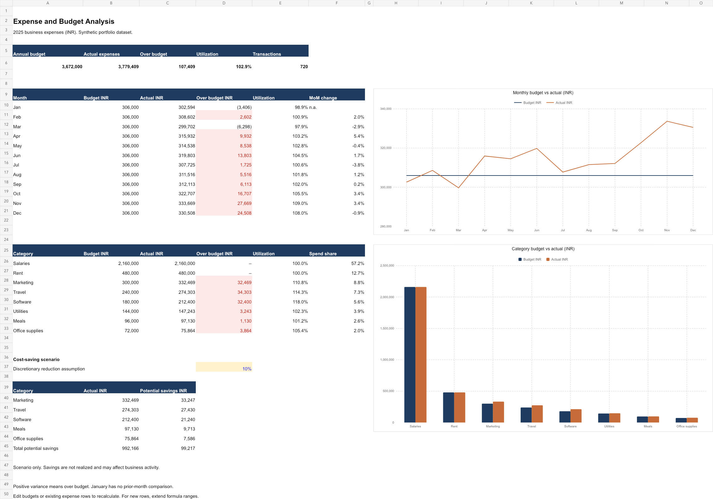

# Expense and Budget Analysis — Excel & SQL

A reproducible portfolio project that tracks business spending, compares monthly and category budgets with actual expenses, and evaluates potential cost reductions.

**Dataset:** 720 synthetic transactions, eight categories, January–December 2025, INR. All vendors, expenses, and budgets are fictional. No private financial data is used.



## Business questions

- Which categories account for the most spending?
- Which months and categories exceed budget?
- How does spending change month over month?
- How much could a hypothetical reduction in discretionary expenses save?

## Results

| Metric | Result |
| --- | ---: |
| Annual budget | ₹3,672,000 |
| Actual expenses | ₹3,779,409 |
| Over budget | ₹107,409 (2.93%) |
| Budget utilization | 102.93% |
| Hypothetical savings at 10% discretionary reduction | ₹99,216.60 |

Travel exceeds its annual budget by ₹34,303, marketing by ₹32,469, and software by ₹32,400. Together these explain ₹99,172, or 92.33% of total net overspend. Salaries account for 57.15% of all spending. November has the highest spending at ₹333,669.

Suggested reviews: assess travel approvals and remote-meeting alternatives, check marketing campaign efficiency before reducing spend, and audit software licenses for unused seats. The dataset has no usage or return-on-investment measures, so these are investigation opportunities rather than proven waste. A 10% reduction in the five discretionary categories represents ₹99,216.60 of potential savings, not realized savings.

## Project contents

```text
data/       CSV inputs and ready-to-query SQLite database
sql/        Schema, budget comparison view, and five analysis queries
scripts/    Deterministic data generation, query execution, and validation
excel/      Formula-driven workbook with two native editable charts
reports/    Exported SQL results and analysis notes
docs/       Dashboard preview and data dictionary
```

## Run the SQL analysis

Requires Python 3.9+ with SQLite window-function support. No pip packages are required.

```bash
python3 scripts/run_analysis.py
```

This regenerates the synthetic data with seed 42, rebuilds `data/expenses.db`, executes `sql/analysis.sql`, and writes the results into `reports/`. It replaces generated data and report files. Copy any custom data elsewhere before running it.

Alternatively, open `data/expenses.db` in a SQLite client and run the queries in `sql/analysis.sql`.

```sql
SELECT category,
       SUM(budget_inr) AS budget_inr,
       SUM(actual_inr) AS actual_inr,
       SUM(over_budget_inr) AS over_budget_inr
FROM budget_vs_actual
GROUP BY category
ORDER BY over_budget_inr DESC;
```

## Use the Excel dashboard

Open `excel/expense_budget_dashboard.xlsx` in Excel. The workbook includes:

- **Dashboard:** annual KPIs, monthly trends, category comparisons, conditional variance highlighting, and an editable cost-saving assumption in D37.
- **Expenses:** transaction-level source table with sortable dates and filter controls.
- **Budgets:** monthly category budget inputs. Editable amounts use blue text.

The dashboard uses `SUMIF`, `SUMIFS`, `IF`, `COUNTA`, and linked native charts. Positive variance means spending exceeds budget. Utilization is actual divided by budget. Missing/zero denominators display `n.a.`. January has no previous-month comparison.

Editing existing source rows recalculates the dashboard. Appending rows requires extending the dashboard's bounded source ranges; charts use fixed 2025 monthly/category summary ranges. Category order is a baseline spend ranking and does not automatically re-sort after edits. The 10% savings assumption changes the scenario only, not actual expenses.

The SQL pipeline and Excel workbook are independent implementations of the same calculations. Regenerating SQL reports does not automatically refresh Excel. For replacement data, update both workbook source sheets, extend ranges as needed, and reconcile totals before presenting results.

## Method and validation

Expense grain is one transaction. Budget grain is one category-month. SQL aggregates transactions before joining to budgets, preventing budget multiplication. A left join retains budget months with no transactions. Foreign keys, positive amounts, unique transaction IDs, and unique budget keys enforce the data model. An explicit coverage check catches expense keys missing from budgets.

Validation passed for 720 transactions and 96 budget rows, database integrity, foreign keys, monthly/category reconciliation, and a zero-actual budget-month fixture. Workbook headline and monthly totals reconcile with SQL, formula-error scanning found no matches, and edits to a budget and savings rate changed the expected dependent results. All three sheets were rendered and visually inspected. Workbook evaluation was checked with the authoring engine; Microsoft Excel desktop recalculation was not independently tested.

## Skills demonstrated

SQL aggregation, CTEs, joins, window functions (`LAG`, `DENSE_RANK`), variance analysis, data modeling, Excel formulas, conditional formatting, native charts, reconciliation, and business interpretation.

## Portfolio description

Built an Excel and SQL expense-analysis project using 720 synthetic transactions across eight categories. Analyzed monthly trends and budget utilization, developed a formula-driven dashboard, and identified ₹107,409 in budget overruns. Modeled ₹99,216.60 in potential savings under a hypothetical 10% discretionary-spend reduction.
